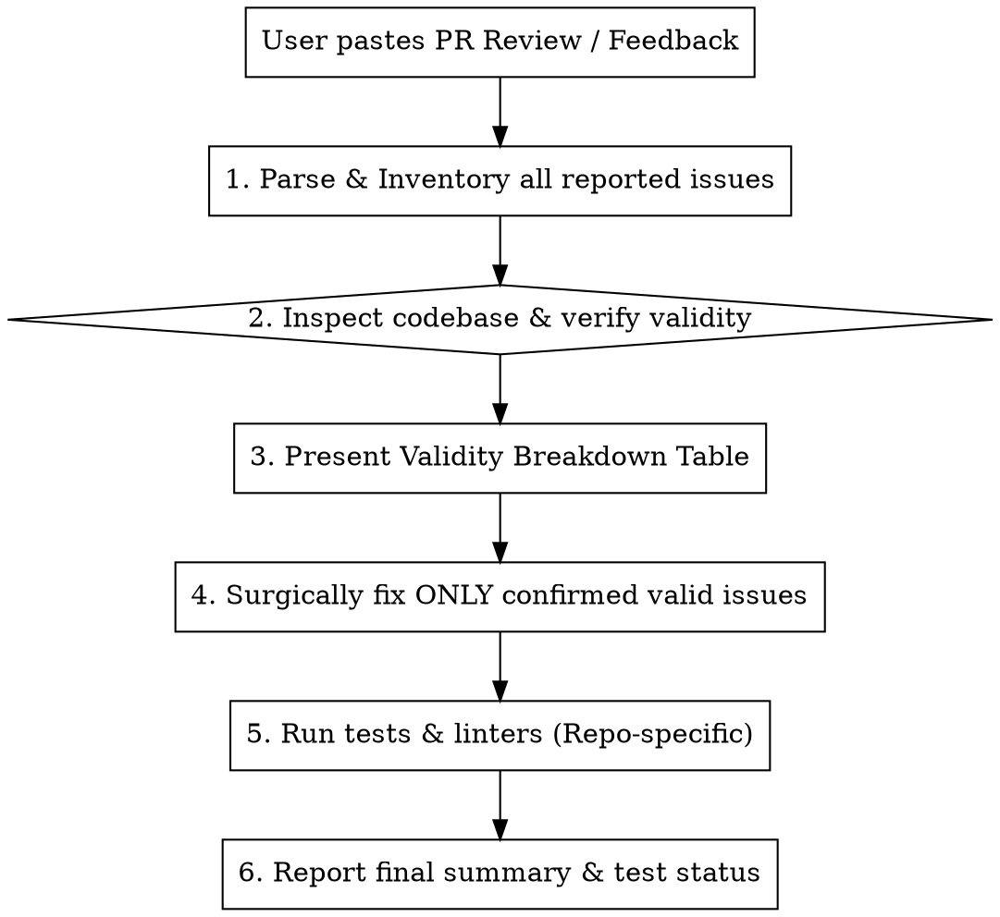

# PR Review Resolver

Systematically triage, verify, and resolve code review feedback (from Antigravity AI Code Review, Claude, Azure DevOps PR threads, or teammates).

## Core Philosophy: The Zero-Trust Reviewer Principle

Automated AI reviewers (and humans reviewing diffs in isolation) review patches without full execution context or architectural intent. As observed across real reviews:
- **Frequent False Positives**: Reviewers often flag intentional design choices as security/privacy bugs (e.g., flagging client-side indexing with encrypted cloud sync as a "privacy leak"), misunderstand upstream mitigations, or assume missing validations that actually exist in middleware/callers.
- **Flawed Fix Suggestions**: Even when an issue is real, the reviewer's proposed fix might be naive, introduce regressions, or break public APIs.
- **Symptom vs. Root Cause**: Reviewers often identify a symptom but miss the real root cause, or overlook an adjacent bug in the same function.

**Rule:** Never blindly apply review feedback. Every single claim must be independently verified against the actual codebase first. Fix **only** confirmed valid issues.

---

## Workflow Steps



---

### Step 1: Parse and Inventory All Findings

Extract every distinct finding from the pasted review:
1. **Severity**: `Critical`, `High`, `Medium`, `Low`, or `Informational`.
2. **Location**: Target file(s), line numbers, and symbol/function name.
3. **Claim**: What flaw does the reviewer claim exists?
4. **Proposed Fix**: What did the reviewer suggest doing?

Do **not** edit any code in this step.

---

### Step 2: Codebase Grounding & Validity Verification

For each reported issue, inspect the actual codebase at the cited location and its surrounding context:

1. **Verify Existence & Context**:
   - Check if the code actually exists as described (diffs in reviews may be stale or out-of-date).
   - Trace callers and callees: is the condition possible at runtime, or is it already guarded upstream?

2. **Check Against Architecture & Intent**:
   - Is the flagged pattern an intentional design decision?
   - Examples of **False Positives (INVALID)**:
     - Flagging local data collection as a privacy violation when the application's core architecture is local-first indexing with encrypted sync.
     - Flagging "missing auth check" on an internal handler that is already mounted behind auth middleware.
     - Suggesting over-engineering (e.g., adding complex retry/backoff for an idempotent in-memory cache lookup).
   - Examples of **Real Issues (VALID)**:
     - Concurrency/race conditions (e.g., thread restart without joining previous thread, non-atomic map/state mutation).
     - Security fail-open bugs (e.g., fallback that grants access to all users when user directory lookup fails).
     - Data loss / logic errors (e.g., premature pagination termination on empty pages with nextLink, unescaped SQL `LIKE` wildcard injection).
     - Resource leaks (e.g., unclosed file descriptors, uncancelled context, listener event memory leaks).
     - N+1 database or API queries inside tight loops.

3. **Check for Latent / Secondary Bugs**:
   - Does fixing the reported problem uncover an adjacent edge case?
   - Note if the reviewer diagnosed the right symptom but proposed the wrong remedy.

4. **Classify Status**:
   - **`VALID`**: Genuine bug, security flaw, race condition, data corruption, or unhandled edge case.
   - **`INVALID`**: False positive, misunderstanding of architectural design, already handled upstream, harmless cosmetic comment, or proposal would cause regressions.
   - **`PARTIALLY VALID`**: Real underlying issue exists, but the reviewer's reasoning or suggested patch is flawed. Fix the real issue cleanly.

---

### Step 3: Present the Validity Breakdown Table

Present a structured evaluation table to the user. Address any specific questions the user asked (e.g., *"the first problem is not valid right?"*):

```markdown
### Validity Breakdown

| # | Severity | Location | Issue Claim | Status | Rationale & Planned Action |
|---|---|---|---|:---:|---|
| 1 | Critical | `src/path/file.ext` | Privacy policy violation | **INVALID** | Local indexing is intentional design; data is encrypted before cloud sync. |
| 2 | High | `src/path/worker.rs` | Race condition on poller restart | **VALID** | Rapid toggle leaves thread hanging. Fix with channel coordination. |
| 3 | Medium | `service/api/handler.go` | Fail-open on empty directory | **VALID** | Falls back to raw allowlist when lookup returns nil. Change to fail-closed error. |
```

---

### Step 4: Surgical Implementation of Valid Fixes

Follow the repository's core guidelines:
1. **Simplicity First**: Minimum code to solve the verified problem. Nothing speculative.
2. **Surgical Changes**: Touch only what you must. Do not refactor adjacent code, change unrelated comments, or reformat untouched files.
3. **Never Fix Invalid Issues**: Do not alter working code to appease a false-positive reviewer comment.
4. **Follow Repo Idioms**:
   - **Backend (`scse-backend`)**:
     - Go 1.26 idioms, error wrapping (`fmt.Errorf("...: %w", err)`), `zerolog` for logging.
     - PostgreSQL Bun ORM migrations (`.up.sql` and `.down.sql`) if schemas change.
     - OpenSearch v3 indices (`files-v3`), Valkey Streams for async tasks.
   - **Desktop (`scse-desktop`)**:
     - Rust backend (`src-tauri/`): Thread safety (`Arc<Mutex<...>>` / channels), SQLite WAL safety, robust error propagation without unexpected panics.
     - React / TypeScript frontend: Clean React hooks, minimal state, Tailwind / Shadcn UI components.
   - **Web (`scse-web`)**:
     - Next.js / TypeScript / Tailwind CSS.
     - Clean separation between Server and Client Components.

---

### Step 5: Verification & Automated Tests

Run the appropriate tests to verify that valid fixes work and no regressions were introduced.

#### Repository Test Cheat Sheet

| Repository | Scope | Verification Command |
|---|---|---|
| **`scse-backend`** | Go unit tests | `go test ./service/internal/api/<pkg>/... -v -race` |
| | Full Go suite | `cd app/scse-cloud && make test` |
| | Go linter | `cd app/scse-cloud && make lint` |
| **`scse-desktop`** | Frontend unit tests | `npm run test:unit` |
| | Rust backend tests | `cargo test --manifest-path src-tauri/Cargo.toml` |
| | Linter | `npm run lint` |
| **`scse-web`** | Frontend tests | `npm test` |
| | Typecheck / Build | `npm run build` or `npx tsc --noEmit` |
| | Linter | `npm run lint` |

Confirm all tests pass cleanly before completing the task.

---

### Step 6: Final Summary

Conclude with a clear, clickable summary:
1. **Confirmed & Fixed**: List of valid issues resolved, linking to files using markdown links (e.g., [`worker.rs`](file:///path/to/worker.rs#L50-L75)).
2. **Rejected / False Positives**: Brief recap of why invalid items were safely skipped.
3. **Verification Results**: Summary of passing unit tests or linter checks.
