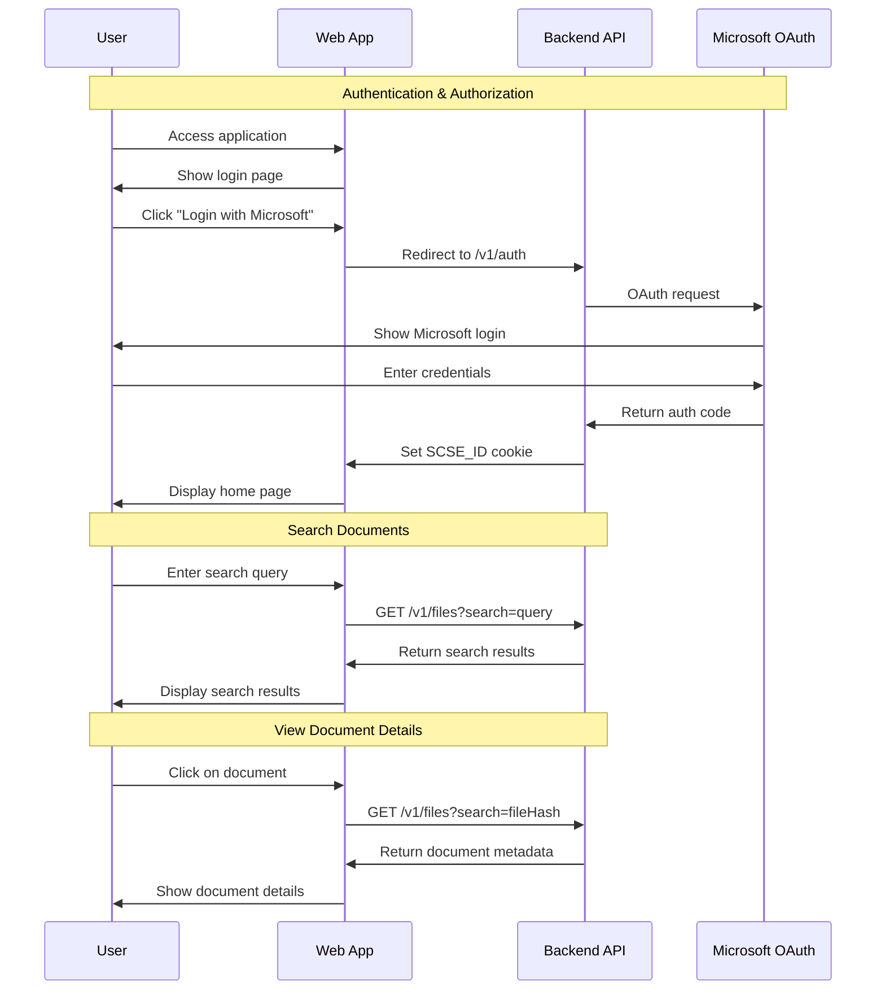

# SCSE Web - Technical Documentation

## Table of Contents

1. [System Overview](#system-overview)
2. [System Architecture](#system-architecture)
3. [Technology Stack](#technology-stack)
4. [Sequence Diagrams](#sequence-diagrams)
5. [Component Architecture](#component-architecture)
6. [API Integration](#api-integration)
7. [Security & Authentication](#security--authentication)
8. [Deployment Architecture](#deployment-architecture)
9. [Development Workflow](#development-workflow)

---

## System Overview

**Secure Corporate Search Engine (SCSE) Web** is a Next.js-based frontend application that provides a secure interface for searching and accessing corporate documents stored across various platforms (OneDrive, Google Drive, etc.). The system implements enterprise-grade authentication via Microsoft OAuth and provides document search, metadata viewing, and access control features.

### Key Features

- 🔐 Microsoft OAuth authentication
- 🔍 Full-text document search across multiple sources
- 📄 Document metadata and version history tracking
- 👥 Access logging and permission management
- 🎯 Type-based filtering (PDF, Office, Google Docs)
- 📱 Responsive design for desktop and mobile

---

## System Architecture

### High-Level Architecture

```
┌────────────────────────────────────────────────────────────┐
│                         Client Layer                       │
│                    (Browser/Mobile Device)                 │
└────────────────────────┬───────────────────────────────────┘
                         │ HTTPS
                         ↓
┌────────────────────────────────────────────────────────────┐
│                    Frontend Application                    │
│                      (Next.js 15.5.6)                      │
│  ┌─────────────────────────────────────────────────────┐   │
│  │           App Router (React Server Components)      │   │
│  │  • Pages (/, /login, /search, /search/[id])         │   │
│  │  • Server Actions (search.ts, me.ts)                │   │
│  │  • Middleware (Auth & Routing)                      │   │
│  └─────────────────────────────────────────────────────┘   │
│  ┌─────────────────────────────────────────────────────┐   │
│  │           Client-Side State Management              │   │
│  │  • Zustand Store (User State)                       │   │
│  │  • React Hooks & Components                         │   │
│  └─────────────────────────────────────────────────────┘   │
└────────────────────────┬───────────────────────────────────┘
                         │ HTTP/HTTPS
                         │ Cookie-based Auth (SCSE_ID)
                         ↓
┌────────────────────────────────────────────────────────────┐
│                      Backend API Layer                     │
│              (api.scse.hyperjump.tech)                     │
│  ┌─────────────────────────────────────────────────────    │
│  │  /v1/auth        - Authentication endpoints         │   │
│  │  /v1/auth/me     - User profile                     │   │
│  │  /v1/auth/logout - Session termination              │   │
│  │  /v1/files       - Document search & retrieval      │   │
│  └─────────────────────────────────────────────────────┘   │
└────────────────────────-───────────────────────────────────┘
```

### Architecture Layers

#### 1. Presentation Layer

- **Next.js App Router**: Server-side and client-side rendering
- **React Components**: UI components using Radix UI primitives
- **Tailwind CSS**: Utility-first styling framework
- **Responsive Design**: Mobile-first approach with breakpoints

#### 2. Application Layer

- **Server Actions**: API calls executed on the server
- **Middleware**: Authentication and route protection
- **State Management**: Zustand for client-side state
- **Form Validation**: Zod schema validation

#### 3. Integration Layer

- **Fetcher Utility**: Centralized API communication
- **Cookie Management**: Session token handling
- **Error Handling**: Structured error responses

#### 4. Infrastructure Layer

- **Docker Container**: Bun-based containerization
- **Azure Container Registry**: Image storage
- **CI/CD Pipeline**: Azure DevOps pipelines
- **Deployment**: SSH-based deployment to servers

---

## Technology Stack

### Frontend Framework

```yaml
Core:
  - Next.js: 15.5.6 (React 19.1.0)
  - TypeScript: 5.x
  - React: 19.1.0
  - React DOM: 19.1.0

Build Tool:
  - Turbopack: Enabled for dev and build
  - Bun: Runtime and package manager

Styling:
  - Tailwind CSS: 4.x
  - PostCSS: Latest
  - tw-animate-css: 1.4.0
  - Class Variance Authority: 0.7.1
  - clsx: 2.1.1
  - tailwind-merge: 3.3.1
```

### UI Component Libraries

```yaml
Radix UI:
  - @radix-ui/react-avatar: 1.1.10
  - @radix-ui/react-dropdown-menu: 2.1.16
  - @radix-ui/react-separator: 1.1.7
  - @radix-ui/react-slot: 1.2.3
  - @radix-ui/react-tabs: 1.1.13

Icons:
  - lucide-react: 0.546.0

Other:
  - @headlessui/react: 2.2.9
```

### State Management & Data

```yaml
State:
  - zustand: 5.0.8

Validation:
  - zod: 4.1.12

HTTP:
  - Native fetch API
  - Server Actions
```

### Development Tools

```yaml
Testing:
  - Playwright: 1.56.1
  - @playwright/test: 1.56.1

Code Quality:
  - ESLint: 9.x
  - Prettier: 3.6.2
  - eslint-config-prettier: 10.1.8
  - eslint-plugin-prettier: 5.5.4

Logging:
  - pino: 10.1.0
  - pino-http: 11.0.0
```

## Sequence Diagram

### Complete User Flow: Login, Search, and View Document



---

## Component Architecture

### Directory Structure

```
src/
├── app/                          # Next.js App Router
│   ├── layout.tsx               # Root layout with Navbar
│   ├── page.tsx                 # Home page with Hero & SearchBar
│   ├── globals.css              # Global styles
│   ├── login/
│   │   └── page.tsx             # Login page
│   ├── logout/
│   │   └── route.ts             # Logout API route
│   ├── search/
│   │   ├── layout.tsx           # Search layout with grid
│   │   ├── page.tsx             # Search results page
│   │   ├── error.tsx            # Error boundary
│   │   ├── loading.tsx          # Loading state
│   │   ├── not-found.tsx        # 404 page
│   │   └── [id]/
│   │       ├── page.tsx         # Document detail page
│   │       └── loading.tsx      # Detail loading state
│   └── api/
│       ├── download/[filename]/ # File download endpoint
│       └── updater/             # App updater endpoint
├── actions/                      # Server Actions
│   ├── search.ts                # Search operations
│   └── me.ts                    # User profile operations
├── components/                   # React Components
│   ├── navbar.tsx               # Main navigation
│   ├── searchbar.tsx            # Search input component
│   ├── hero.tsx                 # Hero section
│   ├── search-result-item.tsx   # Search result card
│   ├── back-button.tsx          # Navigation back button
│   ├── category-tabs.tsx        # Category filter tabs
│   ├── typography.tsx           # Typography components
│   └── ui/                      # Reusable UI components
│       ├── avatar.tsx
│       ├── badge.tsx
│       ├── button.tsx
│       ├── card.tsx
│       ├── dropdown-menu.tsx
│       ├── input.tsx
│       ├── separator.tsx
│       ├── skeleton.tsx
│       ├── spinner.tsx
│       └── tabs.tsx
├── lib/                         # Utility functions
│   ├── env.ts                   # Environment validation
│   ├── fetcher.ts               # API client
│   ├── format-file-size.ts      # File size formatter
│   ├── format-time-ago.ts       # Time formatting
│   ├── get-file-icon-path.ts    # File icon resolver
│   └── utils.ts                 # General utilities
├── stores/                      # State management
│   └── user.ts                  # User store (Zustand)
├── data/                        # Static data
│   └── data.json                # Mock data for demo
└── middleware.ts                # Route protection & auth
```

### Key Components

#### 1. **Root Layout** (`app/layout.tsx`)

- Fetches user data on server
- Initializes user store
- Renders Navbar
- Provides global structure

#### 2. **Middleware** (`middleware.ts`)

- Cookie-based authentication
- Route protection
- Redirect logic
- Query validation

#### 3. **Server Actions** (`actions/`)

- **search.ts**: Document search operations
- **me.ts**: User profile retrieval
- Server-side data fetching
- Data transformation

#### 4. **State Management** (`stores/user.ts`)

- Zustand store for user state
- Client-side state initialization
- Logout functionality

#### 5. **API Client** (`lib/fetcher.ts`)

- Centralized fetch wrapper
- Cookie injection
- Error handling
- URL construction

---

## API Integration

### Backend Endpoints

| Endpoint                   | Method | Purpose             | Auth Required |
| -------------------------- | ------ | ------------------- | ------------- |
| `/v1/auth`                 | GET    | Initiate OAuth flow | No            |
| `/v1/auth/me`              | GET    | Get current user    | Yes           |
| `/v1/auth/logout`          | POST   | Terminate session   | Yes           |
| `/v1/files?search={query}` | GET    | Search documents    | Yes           |

### Request Flow

1. **Client Request** → Server Component/Action
2. **Server Action** → fetcher utility
3. **fetcher** → Backend API (with SCSE_ID cookie)
4. **Backend** → External services (Microsoft, Elasticsearch)
5. **Response** → Data transformation
6. **Render** → Client display

### Data Models

```typescript
// User Model
type User = {
  name?: string;
  initialName?: string; // First 2 letters
  email?: string;
};

// Search Result Model
type SearchResult = {
  fileHash: string;
  fileName: string;
  filePath: string;
  fileSize: string; // Formatted
  fileIcon: string; // Icon path
  ownerEmail: string;
  createdTime: string; // Relative format
  updatedTime: string; // Relative format
};

// Backend Response Structure
type APIResponse = {
  value: {
    _source: {
      hash: string;
      name: string;
      path: string;
      size: number;
      extension: string;
      owner_email: string;
      created_at: string;
      updated_at: string;
    };
  }[];
};
```

---

## Security & Authentication

### Authentication Mechanism

1. **OAuth Flow**: Microsoft OAuth 2.0
2. **Session Management**: HTTP-only cookies (SCSE_ID)
3. **Token Storage**: Server-side only (not exposed to client)
4. **CSRF Protection**: Same-site cookie policy

### Security Features

- ✅ Server-side authentication checks
- ✅ Middleware-based route protection
- ✅ No token exposure to client JavaScript
- ✅ Secure cookie transmission (HTTPS)
- ✅ Environment variable validation (Zod)
- ✅ Input sanitization
- ✅ XSS protection via React
- ✅ Content Security Policy headers (Next.js defaults)

### Protected Routes

All routes except `/login` require authentication:

- `/` - Home page
- `/search` - Search results
- `/search/[id]` - Document details
- `/logout` - Logout endpoint

### Cookie Configuration

```typescript
// Cookie name: SCSE_ID
// Attributes:
// - HttpOnly: true (not accessible via JavaScript)
// - Secure: true (HTTPS only in production)
// - SameSite: Lax (CSRF protection)
// - Path: / (available to all routes)
```

---

## Deployment Architecture

### Container Structure

```
┌──────────────────────────────────────────────┐
│         Docker Container (Bun-based)         │
├──────────────────────────────────────────────┤
│  Base: oven/bun:1                            │
├──────────────────────────────────────────────┤
│  Stage 1: deps                               │
│  - Install dependencies                      │
│  - Apply patches                             │
├──────────────────────────────────────────────┤
│  Stage 2: builder                            │
│  - Copy dependencies                         │
│  - Set environment variables                 │
│  - Build Next.js app                         │
│  - Generate standalone output                │
├──────────────────────────────────────────────┤
│  Stage 3: runner (Production)                │
│  - Copy build artifacts                      │
│  - Run as non-root user (nextjs:1001)        │
│  - Expose port 3000                          │
│  - Start with: bun ./server.js               │
└──────────────────────────────────────────────┘
```

### CI/CD Pipeline

```
┌─────────────────────────────────────────────────────────┐
│                    Azure DevOps Pipeline                 │
└─────────────────────────────────────────────────────────┘

Trigger: Push to main OR tag creation

┌─────────────────────────────────────────────────────────┐
│ Stage 1: Build & Test (All branches)                    │
├─────────────────────────────────────────────────────────┤
│ 1. Install Bun                                          │
│ 2. Install dependencies (bun install)                   │
│ 3. Run linting (bun run lint)                          │
│ 4. Build application (bun run build)                   │
└─────────────────────────────────────────────────────────┘
                         │
                         ↓
┌─────────────────────────────────────────────────────────┐
│ Stage 2: Deploy to Staging (main branch only)          │
├─────────────────────────────────────────────────────────┤
│ 1. Build Docker image                                   │
│    - Tag: {BuildId}-rc, test                           │
│    - Build args: staging_build_arguments               │
│ 2. Push to Azure Container Registry                    │
│ 3. SSH to PoC server                                   │
│ 4. Update .env with new tag                            │
│ 5. Docker compose up -d                                │
└─────────────────────────────────────────────────────────┘
                         │
                         ↓
┌─────────────────────────────────────────────────────────┐
│ Stage 3: Release to Production (tags only)             │
├─────────────────────────────────────────────────────────┤
│ 1. Install Playwright & browsers                        │
│ 2. Run E2E tests (bun run test:e2e)                   │
│ 3. Publish test results & reports                      │
│ 4. Parse version tag (strip 'v' prefix)               │
│ 5. Build production Docker image                       │
│    - Tags: {version}, latest                           │
│    - Build args: production_build_arguments            │
│ 6. Push to Azure Container Registry                    │
│ 7. SSH to production server                            │
│ 8. Update .env with version tag                        │
│ 9. Docker compose up -d                                │
└─────────────────────────────────────────────────────────┘
```

### Environment Management

```yaml
Development:
  - Local machine
  - Hot reload with Turbopack
  - Commands: bun dev

Staging:
  - Docker container
  - Deployed on push to main
  - Tag: {BuildId}-rc, test
  - Backend: Staging API

Production:
  - Docker container
  - Deployed on tag creation (e.g., v1.0.0)
  - Tags: {version}, latest
  - E2E tests required
  - Backend: Production API
```

### Deployment Commands

```bash
# Development
bun install
bun dev

# Build
bun run build

# Docker Build
docker build \
  --build-arg APP_BASE_URL=https://scse.hyperjump.tech \
  --build-arg BACKEND_BASE_URL=https://api.scse.hyperjump.tech \
  -t scse-web-app \
  -f Dockerfile .

# Docker Run
docker run -p 3000:3000 scse-web-app

# E2E Tests
bunx playwright install
bun run test:e2e
```

---

## Development Workflow

### Local Development Setup

```bash
# 1. Install dependencies
bun install

# 2. Set environment variables
# Create .env.local file
APP_BASE_URL=http://localhost:3000
BACKEND_BASE_URL=https://api.scse.hyperjump.tech

# 3. Run development server
bun dev

# 4. Access application
# Open http://localhost:3000
```

### Code Quality Tools

```bash
# Linting
bun run lint

# Auto-fix linting issues
bun run format

# Type checking (implicit in build)
bun run build
```

### Testing Strategy

```bash
# End-to-End Tests
bun run test:e2e          # Headless mode
bun run test:e2e:headed   # With browser UI
bun run test:e2e:ui       # Interactive mode
bun run test:e2e:report   # View last report

# Test Coverage
# - Login flow
# - Search functionality
# - Responsive behavior
# - Authentication scenarios
```

### Git Workflow

```bash
# Feature development
git checkout -b feature/your-feature
# ... make changes ...
git commit -m "feat: add feature"
git push origin feature/your-feature
# Create PR to main

# Staging deployment (automatic)
git checkout main
git merge feature/your-feature
git push origin main
# Triggers staging deployment

# Production release
git tag v1.0.0
git push origin v1.0.0
# Triggers production deployment with E2E tests
```

### Project Scripts

| Command                   | Description                             |
| ------------------------- | --------------------------------------- |
| `bun dev`                 | Start development server with Turbopack |
| `bun run build`           | Build for production with Turbopack     |
| `bun start`               | Start production server                 |
| `bun run lint`            | Run ESLint                              |
| `bun run format`          | Auto-fix code with ESLint & Prettier    |
| `bun run test:e2e`        | Run Playwright E2E tests                |
| `bun run test:e2e:headed` | Run tests with visible browser          |
| `bun run test:e2e:ui`     | Open Playwright UI                      |
| `bun run test:e2e:report` | Show test report                        |

---

## Performance Optimizations

### Next.js Features

1. **Server Components**: Default for all components, reducing client bundle
2. **Server Actions**: API calls without client-side code
3. **Turbopack**: Fast build and HMR
4. **Standalone Output**: Minimal production bundle
5. **Image Optimization**: Next.js Image component
6. **Font Optimization**: next/font with Inter font
7. **Code Splitting**: Automatic route-based splitting

### Bundle Optimization

- **Tree Shaking**: Remove unused code
- **Minification**: Production build optimization
- **Compression**: Gzip/Brotli compression
- **Static Assets**: Caching headers
- **Lazy Loading**: Dynamic imports where needed

### Caching Strategy

```typescript
// API calls use Next.js cache by default
// Server Actions are cached per request
// Static assets are cached indefinitely
// Dynamic routes are generated on-demand
```

---

## Monitoring & Logging

### Logging Infrastructure

```typescript
// Server-side logging with Pino
import pino from "pino";
import pinoHttp from "pino-http";

// Structured JSON logs
// Request/response logging
// Error tracking
```

### Error Handling

1. **Error Boundaries**: React error boundaries for UI errors
2. **Try-Catch**: Server action error handling
3. **HTTP Errors**: Graceful API error responses
4. **User Feedback**: User-friendly error messages

---

## Future Enhancements

### Planned Features

- [ ] Advanced search filters (date range, file type, owner)
- [ ] Document preview in-app
- [ ] Bulk download functionality
- [ ] Search history and saved searches
- [ ] Real-time notifications
- [ ] Analytics dashboard
- [ ] Multi-language support
- [ ] Dark mode theme
- [ ] Mobile app

### Technical Improvements

- [ ] Implement comprehensive unit tests
- [ ] Add integration tests
- [ ] Performance monitoring (Sentry, DataDog)
- [ ] CDN integration
- [ ] Redis caching layer
- [ ] GraphQL API migration
- [ ] WebSocket for real-time updates
- [ ] PWA capabilities

---

## Appendix

### Environment Variables Reference

| Variable           | Description     | Required | Example                           |
| ------------------ | --------------- | -------- | --------------------------------- |
| `APP_BASE_URL`     | Frontend URL    | Yes      | `https://scse.hyperjump.tech`     |
| `BACKEND_BASE_URL` | Backend API URL | Yes      | `https://api.scse.hyperjump.tech` |

### Browser Support

- Chrome: Latest 2 versions
- Firefox: Latest 2 versions
- Safari: Latest 2 versions
- Edge: Latest 2 versions

### License

Private/Proprietary - All rights reserved

### Contact

For technical support or questions, contact the development team.

---

**Document Version**: 1.0  
**Last Updated**: November 20, 2025  
**Maintained By**: SCSE Development Team
